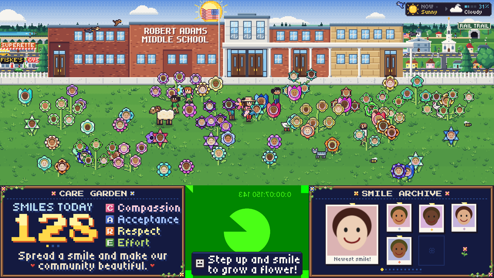
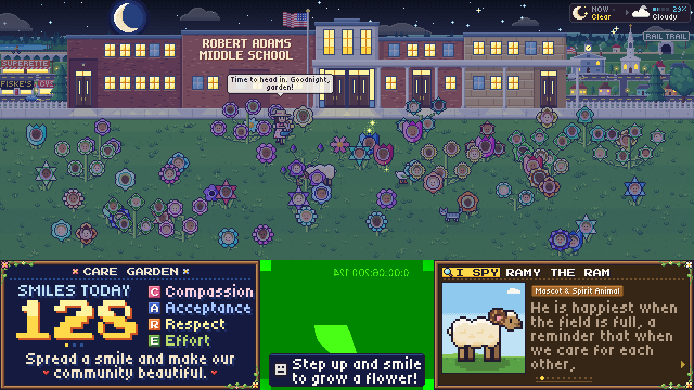

# CARE Garden

An interactive garden simulation built for **Robert Adams Middle School** in Holliston, MA. Students smile at a webcam to grow flowers, building a shared CARE score displayed on a large TV in the school.

Every smile plants a flower with the student's face at its center. Smile together and you'll grow a group flower. The garden lives and breathes on its own — characters wander, weather changes, and the sun rises and sets throughout the day.

The whole garden is drawn as pixel art.





## How It Works

1. Stand in front of the camera and **smile**
2. Hold your smile for about a second
3. A flower grows in the garden with your face in the center
4. Smile with friends nearby to grow a **group flower** (up to 6 faces!)
5. Watch your CARE score climb

## What You'll See

### The Garden
A living world with a full day/night cycle (~15 minutes per day), dynamic weather (sun, clouds, rain, storms), and a pixel-art school building modeled after Robert Adams Middle School. The town of Holliston appears in the background with its church, town hall, and rail trail.

### The Characters

| Character | What They Do |
|---|---|
| **Ramy the Ram** | School mascot. Grazes on flowers, leaves behind "gifts" that bloom into new flowers. Kids can pet him! |
| **The Gardener** | Waters flowers to help them grow. Opens her umbrella in the rain. Runs from the goose. |
| **The Students** | Explore the garden, pick flowers, and pet the ram. |
| **The Goose** | Local menace. Chases the gardener. Quacks aggressively. |
| **The Cat** | Stalks butterflies and bees, naps in the sun, dramatically flees from rain. |
| **Principal Manning** | Greets students at the door each morning. Waves everyone inside when it rains. |
| **Teachers** | Walk to school at dawn, head home at dusk. |
| **Mr. Perkins** | Creator of the garden. Makes cameo appearances to cheer everyone on. |
| **Mr. Conant** | CARE team lead. Drops by looking for Adin or Mrs. Conant. |
| **Groundhog** | Pops up from a hole, looks around nervously, and disappears. |
| **Rabbits** | Hop across the screen. Panic during storms. |
| **Butterflies, Bees & Birds** | Flutter and fly through the garden during the day. |

### Weather & Time
- The sky transitions through dawn, morning, midday, golden hour, sunset, dusk, and night
- Weather cycles between sunny, cloudy, rainy, and stormy
- When it rains, pixel hats and crowns appear on detected faces ("Hat Time!")
- Fireflies come out at night; stars twinkle overhead

### Dawn & Dusk
- At dawn, teachers and students with backpacks walk toward the school
- Principal Manning opens the door to greet them
- At dusk, everyone heads home — teachers, students with backpacks, and the principal says goodbye
- The gardener goes inside at night and returns at dawn

## Running Locally

No build tools required — it's plain HTML with script tags.

```bash
cd care-garden
python3 server.py
```

Open **http://localhost:8000** in Chrome. You'll need to allow camera access. `server.py` also saves the smile counts to `stats.json` so they survive a browser restart (`python3 server.py 8080` uses another port).

> **Note:** The webcam requires HTTPS or localhost. If hosting remotely, use a service that provides HTTPS (GitHub Pages, Netlify, etc.). Without `server.py` the counts are kept in the browser only.

The libraries load from their CDNs and fall back to the copies in this folder if the network is down. The face-detection models are still downloaded at startup, so the camera features need an internet connection.

### Trying things without a camera

Add parameters to the address to set up a scene:

```
http://localhost:8000/?t=0.9&weather=rainy&flowers=40&spawn=kids
```

| Parameter | What it does |
|---|---|
| `t` | Time of day, 0 to 1 (0.3 morning, 0.6 golden hour, 0.9 night) |
| `weather` | `sunny`, `cloudy`, `rainy`, `stormy` or `clearing` |
| `flowers` | Plant this many demo flowers with stand-in faces (`settled=1` shows them at garden size) |
| `spawn` | Comma list: `kids`, `rabbit`, `birds`, `groundhog`, `perkins`, `conant`, `principal`, `teachers`, `arrivals`, `departures`, `confetti`, `hats` |
| `panel` | Pin the right-hand panel: `gallery`, `ram`, `gardener`, `kids`, `school`, ... |
| `score`, `speed`, `freeze`, `seed` | Set the count, change or stop the clock, fix the random layout |

`tools/sprites.html` shows every sprite enlarged, and `node tools/shot.js <url> out.png` takes a screenshot in headless Chrome with a fake camera (needs [Playwright](https://playwright.dev/)).

## Keyboard Controls

| Key | Action |
|---|---|
| `M` | Mute / unmute audio |
| `R` | Force rain |
| `S` | Force sunny |
| `T` | Force storm |
| `D` | Jump to dawn |
| `N` | Jump to night |
| `G` | Jump to golden hour |
| `H` | Toggle hat decorations |
| `UP / DOWN` | Speed up / slow down day cycle |
| `LEFT / RIGHT` | Cycle character info panel |
| Click | Toggle fullscreen |

## Tech Stack

- **[p5.js](https://p5js.org/)** — Canvas, input, sound and the draw loop
- **PX** (`js/pixel.js`) — The garden's own small pixel-art renderer: one shared pixel grid, a palette, sprites typed out as text, and bitmap text
- **[ml5.js](https://ml5js.org/)** — Face detection with expression recognition (faceApi)
- **[nsfwjs](https://nsfwjs.com/)** — Content moderation on camera frames
- Plain HTML, no bundler or build step

## Project Structure

```
care-garden/
  index.html              Entry point — loads all scripts
  sketch.js               Main setup() and draw() loop
  server.py               Local server; saves smile stats to stats.json
  style.css               Minimal styles
  js/
    pixel.js               PX pixel-art engine and the master palette
    art/                   Sprite definitions (animals, people, flowers, hats, ...)
    audio.js               Safe sound playback helpers
    constants.js           Config, keyframes, character cards, phrases
    globals.js             All mutable global state
    world.js               Coordinate system and day/night helpers
    scene.js               Sky, lawn, trees, school building
    town.js                Town backdrop (shops, cars, walkers)
    weather.js             Weather state machine and rain/storm effects
    flowers.js             Flower class: types, growth, faces
    creatures.js           Butterfly, Bee, Bird classes
    ui.js                  CARE score, gallery, I SPY cards, speech bubbles, confetti
    facedetection.js       Face detection, smile tracking, hat overlays
    characters/            Ram, gardener, students, goose, cat, rabbit, groundhog,
                           teachers, Principal Manning, Mr. Perkins, Mr. Conant
  docs/
    PIXEL_ART.md           How the pixel art works and the rules for adding to it
  tools/
    sprites.html           Sprite sheet viewer
    shot.js                Screenshot tool
  fonts/                   Pixel fonts (Tiny5, Press Start 2P — SIL Open Font License)
  sounds/
    birds.mp3, rain.mp3, night.mp3, sheep.wav, ...
```

Want to draw a new character or flower? Start with `docs/PIXEL_ART.md`; the rabbit (`js/characters/rabbit.js` and its sprite in `js/art/animals_art.js`) is the smallest complete example.

## The CARE Score

Every face captured becomes a flower and adds to the school's CARE score. The score is tracked with daily counts, weekly totals, and an all-time record — saved in the browser and, when run with `server.py`, in `stats.json`. Milestones trigger confetti celebrations.

## Credits

Built by **Cole Perkins** for the students, teachers, and staff of Robert Adams Middle School.
